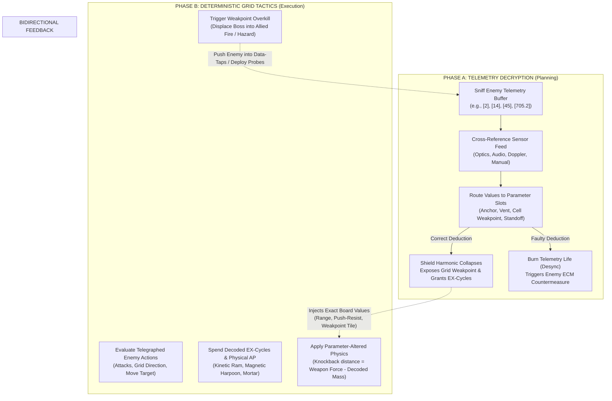
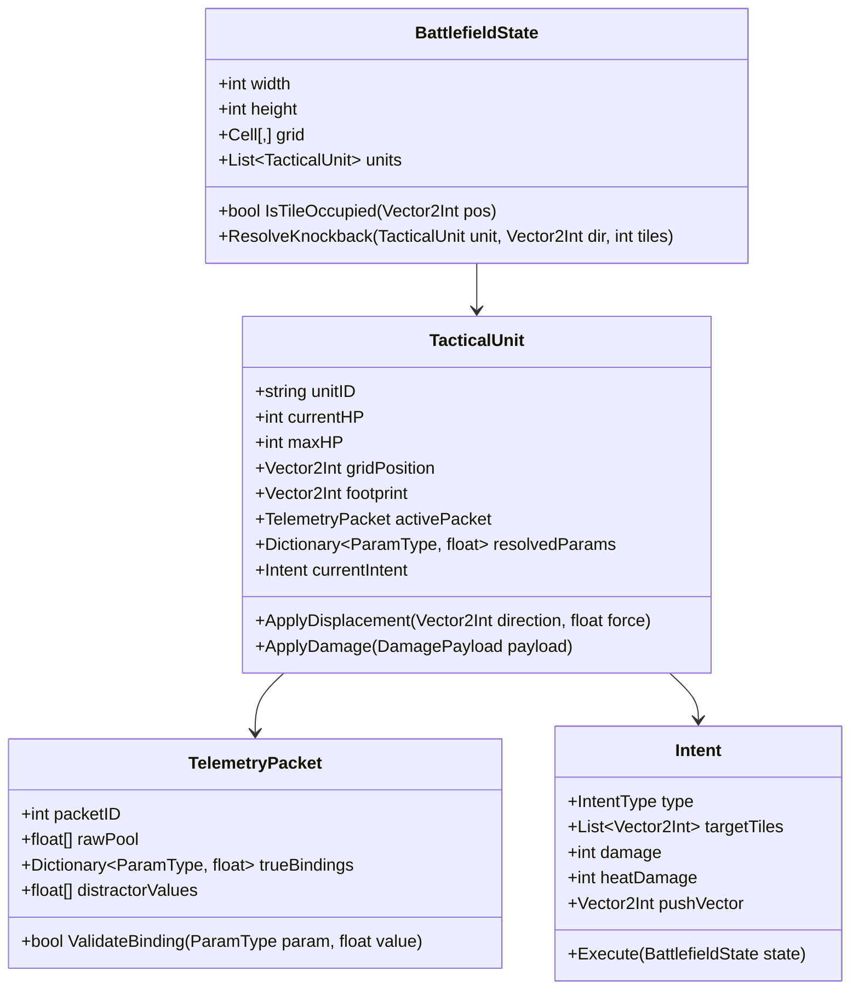
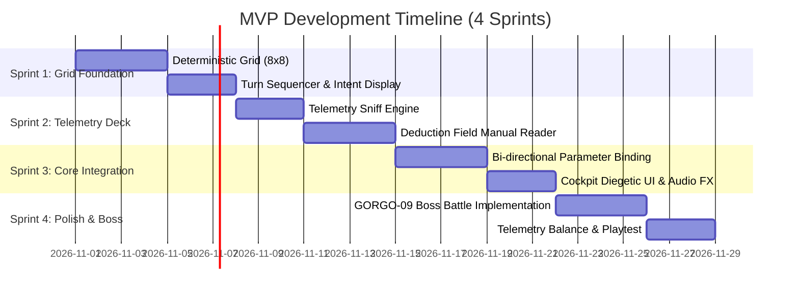

# CIPHER BREACH
## Game Design Document & Technical Architecture Specification
**Working Title:** *Cipher Breach* 
**Document Version:** 1.0.0 (Milestone: Pre-Production Architecture) 
**Target Platforms:** PC (Steam / Windows / Linux / Steam Deck) 
**Engine Target:** Unity 6 / Godot 4.3 (C# Headless Core) 
**Primary Inspirations:** *Into the Breach*, *Cryptmaster*, *Lorelei and the Laser Eyes*, *Keep Talking and Nobody Explodes*

---

## 1. Executive Summary & High Concept

### 1.1 One-Sentence Pitch
*Cipher Breach* is a deterministic, low-RNG tactical mech combat simulator where targeting computers cannot fire through adaptive electronic warfare shields without a weapons officer first reverse-engineering the enemy's raw, unlabelled telemetry registers.

### 1.2 Core Pillars
1. **Deductive Parity:** The game never tests pure trivia or arbitrary guessing; every raw telemetry integer is logically deducible through visual cues, environmental context, sensor audio, and battlefield manuals.
2. **Deterministic Mechanical Causality:** Like *Into the Breach*, enemy intents are 100% telegraphed. Combat relies on spatial displacement, knockback collision, friendly-fire manipulation, and line-of-sight denial.
3. **Diegetic Symbiosis:** The decryption phase (Macro/Planning) and the tactical grid phase (Micro/Execution) do not exist in separate menus or mini-games; they share a single unified cockpit CRT display where decoded data directly alters the physical ballistic physics of that turn.

---

## 2. Thematic Justification & Narrative Diegesis

### 2.1 The Lore: Electronic Warfare in the Post-Silence Era
In the mid-22nd century, the Eurasian Expanse is contested by autonomous, self-manufacturing war-chassis known as **Acro-Frames**. Human pilots cannot match AI reaction speeds in pure kinetic duels. However, every autonomous war-machine relies on **Dynamic Flux-Plating (DFP)**—a reactive energy barrier that recalculates atomic lattice resonance milliseconds prior to impact.

A blind kinetic slug or missile is deflected with 100% efficiency. 

To destroy an Acro-Frame, an attacking unit must execute a **Harmonic Bypass**:
The enemy’s internal bus broadcasts an encrypted, non-human-readable pulse of telemetry to its shield generators, hydraulic dampers, and micro-thrusters. The human player commands an advanced **EW-Tactical Recon Platform (Chassis: SIG-04 "Orthrus")** featuring a two-person crew:
* **The Intercept Officer (The Player's Left Hand / Analytical Mind):** Sniffs unlabelled raw numbers over the enemy’s local wireless databus.
* **The Vanguard Pilot (The Player's Right Hand / Spatial Mind):** Maneuvers the mech across an 8×8 battlefield grid, pushing, pulling, and angling firing vectors into newly exposed bypass windows.

### 2.2 Why Unlabelled Numbers?
Military-grade encryption strips protocol headers (`ID_TAG`, `METRIC_LABEL`) to deny automated interception. The enemy computer simply sends arrays of raw primitives (`float32`, `uint8`, `int16`) over its internal bus. 

Because the laws of physics and engineering cannot be encrypted, a human operator who observes:
* A heavy quad-legged tank deploying 2 grounding claws into concrete,
* A laser rangefinder reading 700 meters,
* A massive single-shot spinal cannon with 4 heat-sink coils,
...can deduce which of the numbers `[2]`, `[14]`, `[45]`, `[705.2]` corresponds to **Anchor Claws deployed**, **Coil Vent Threshold**, **Chassis Armor Tier**, and **Standoff Distance**.

---

## 3. Dual Core Loop Architecture

The game loop operates on a cyclical, bidirectional data exchange between the **Telemetry Decryption Deck** and the **Tactical Grid**.



### 3.1 Loop Handoff 1: Decryption $\rightarrow$ Tactical Grid
When the player correctly maps numbers to parameters:
1. **Shield Strip & Weakpoint Projection:** The targeted enemy unit loses its passive barrier. One or more of its constituent grid cells (or directional facings) highlights with an amber **Vulnerable Core Glyph**.
2. **Physical Parameter Instantiation:** The decoded numbers become active combat variables for that turn:
   * *Decoded Standoff Metric ($705.2\text{ m}$):* The player’s artillery shell flight time calculates instantaneously; trajectory dispersion reduces to zero on that exact tile.
   * *Decoded Mass/Anchor Rating ($45\text{ kN}$):* Sets the threshold required for kinetic knockback. An attack with $50\text{ kN}$ force pushes the enemy exactly $\lfloor (50 - 45) / 5 \rfloor = 1$ tile.
   * *Decoded Vent Threshold ($14\text{ MJ}$):* Any thermal attack dealing $\ge 14\text{ damage}$ causes an instant reactor overheat (1-turn stun + steam cloud).
3. **Execution Energy Generation:** Every correct deduction awards $+1\text{ EX-Cycle}$ (used for specialized tactical overrides like free micro-dashes or shield overcharges).

### 3.2 Loop Handoff 2: Tactical Grid $\rightarrow$ Decryption
Combat positioning generates critical SIGINT clues:
1. **Sensor Proximity:** Moving within 2 tiles of an enemy removes 1 decoy/distractor value from their incoming telemetry pool.
2. **Directional Acoustics:** Standing directly in front of an enemy’s primary weapon muzzle exposes its internal firing frequency before it fires.
3. **Data-Tap Nodes & Pushes:** Knocking an enemy into a "Comm-Relay Tower" or "Seismic Sensor Plate" immediately auto-decodes one parameter (e.g., stamping the exact Weight or Thermal status onto the player's console).

---

## 4. Mechanic Breakdown: Genre A (Numeric Context Decryption)

### 4.1 Telemetry Pool Mechanics
When selecting a target on the board, the player's SIGINT console pulls a packet of **3 to 5 raw numbers**.
* **Base Target:** 3 numbers (3 valid parameters, 0 distractors).
* **Elite/Sub-Boss:** 4 numbers (3 valid parameters, 1 decoy/noise value).
* **Boss (Colossus):** 5 numbers (4 valid parameters, 1 decoy/noise value, plus dynamic drift).

#### The Target Parameter Slots
| Parameter Key | Name | Data Type | Physical Combat Manifestation |
| :--- | :--- | :--- | :--- |
| `PARAM_MASS` | Hydraulic Anchor / Inertia | Integer ($[10 - 90]$) | Sets knockback resistance threshold on the grid. |
| `PARAM_VENT` | Thermal Dissipation Limit | Integer ($[5 - 35]$) | Exceeding this value with Energy attacks inflicts Stun. |
| `PARAM_CELL` | Structural Sub-Cell Core | Coordinate / ID ($[1 - 64]$) | Exposes internal grid coordinate $(X, Y)$ for critical hits. |
| `PARAM_RANGE`| Target Standoff Distance | Float ($[100.0 - 999.9]$) | Zeroes ballistic artillery dispersion; bypasses LoS blockers. |
| `PARAM_CLASS`| Chassis Silhouette Class | Small Int ($[1 - 5]$) | Unlocks weapon-class vulnerability matrix. |

### 4.2 Deductive Heuristics & Sensor Clues
The player does not guess. They cross-reference the numbers with four diegetic information channels:

```
+-----------------------------------------------------------------------------+
| [OPTICAL CHASSIS SCANNER]     | [SIGINT SPECTRUM ANALYZER]       |
| Silhouette: Quadruped Bipedal   | Carrier: 433.92 MHz           |
| Visible Exhaust Vanes: 2 pairs (4)| Doppler Shift: -14.2 m/s (Retreating)  |
| Hydraulic Strut Gauge: Type-III  | Audio Pitch: 120 Hz hum (Dual-Phase)  |
+-----------------------------------------------------------------------------+
| [TACTICAL FIELD MANUAL - EXTRACT #84: "SIEGE-BEETLE PATTERNS"]       |
| * Type-III Hydraulic Struts register anchor loads between 40-50 kN.     |
| * Exhaust manifold volume = (Vane Count * 3.5 MJ).             |
| * Standoff coordinates always contain a non-zero decimal fraction.      |
+-----------------------------------------------------------------------------+
```

*From the above readout:*
* Raw pool: `[4]`, `[14]`, `[48]`, `[620.4]`
* `620.4` has a decimal fraction $\rightarrow$ `PARAM_RANGE` ($620.4\text{ m}$).
* Vanes = $4$; $4 \times 3.5 = 14\text{ MJ}$ $\rightarrow$ `PARAM_VENT` ($14$).
* Strut Type-III load is between $40\text{ and }50\text{ kN}$ $\rightarrow$ `48` is `PARAM_MASS`.
* `4` is a distractor/vane count raw echo!

### 4.3 Deductive Economy & Failure States
* **Telemetry Buffer Integrity (Life):** The player starts each encounter with $100\%$ Buffer Integrity.
* **Faulty Bind:** Submitting an incorrect number burns $-25\%$ Buffer.
* **Desync Countermeasure:** When Buffer reaches $0\%$, or upon a critical misfire, the enemy unit triggers a **Hardline Countermeasure**:
  * *ECM Chaff:* Randomizes the player's weapon ranges for 1 turn.
  * *Thermal Flare:* Ignites adjacent 4 tiles on the grid with fire hazard.
  * *Reaction Pivot:* Instantly turns 90 degrees, changing its telegraphed attack line.

---

## 5. Mechanic Breakdown: Genre B (Deterministic Grid Tactics)

### 5.1 Battlefield Geometry & Unit Topology
* **Grid Format:** $8 \times 8$ or $10 \times 10$ orthogonal grid.
* **Player Squad:** 3 Mechs with distinct tactical roles:
  1. **SIG-Striker (Vanguard):** High mobility, directional kinetic knockback (Piston Ram, Shotgun).
  2. **SIG-Aegis (Anchor):** Heavy chassis, magnetic grappling hooks (pulls units into line), shields allies.
  3. **SIG-Arbiter (Artillery):** Indirect fire, deploys smoke/EMP tiles, requires exact range calibration.
* **Enemy Units:**
  * Minions ($1 \times 1$ footprint): 1–2 telemetry slots.
  * Colossi / Bosses ($2 \times 2$ or $3 \times 3$ footprint): Multi-tile hitboxes, separate directional armor facings, 3–5 telemetry slots.

### 5.2 Deterministic Intent System
At the beginning of each turn:
1. Every enemy unit locks an **Intent Telegraph**:
   * Red Reticle / Highlighted Path: exact tiles that will take damage at the end of the turn.
   * Intent Tooltip: Damage amount, push vector direction, secondary status effects.
2. The player has infinite time during the planning phase to examine outcomes.
3. Every player attack is 100% deterministic (no $85\%$ hit-chance rolls). If a weapon does $3\text{ damage}$ and $1\text{ tile knockback}$, it will always do precisely that.

### 5.3 Emergent Spatial Interactions
* **Collision Damage:** If an enemy is knocked into another unit or a mountain, both take $+1\text{ Kinetic Bump Damage}$.
* **Hazard Displacement:** Knocking an enemy into deep water instantly disables non-amphibious chassis; knocking into an EMP storm tile resets their attack timer.
* **Friendly-Fire Redirection:** By knocking an enemy boss 1 tile sideways, its catastrophic railgun beam now obliterates its own minion escort instead of the civilian defense objective.

---

## 6. Diegetic UI/UX Flow

### 6.1 Unified Cockpit Interface Design
To eliminate the sensation of playing "two separate mini-games", *Cipher Breach* presents a unified physical cockpit console inspired by military signal stations and retro-futuristic displays.

```
+----------------------------------------------------------------------------------------------------+
| [CIPHER BREACH - RECON OS v4.2]                     PILOT INTEGRITY: [||||||] |
+--------------------------------------------------+-------------------------------------------------+
| SECTION 1: SIGINT / EW CONSOLE (LEFT 40%)    | SECTION 2: TACTICAL HOLOGRID (RIGHT 60%)    |
|                         |                         |
| TARGET: [GORGO-09 SIEGE CHASSIS]         |   A  B  C  D  E  F  G  H      |
| SIGNAL FREQ: 433.90 MHz || S/N RATIO: 94 dB   |  +---+---+---+---+---+---+---+---+     |
|                         | 1 | . | . | . | . | . | . | . | . | 1    |
| RAW TELEMETRY REGISTERS:             |  +---+---+---+---+---+---+---+---+     |
|  [ 2 ]  [ 14 ]  [ 45 ]  [ 88.4 ]     | 2 | . |[P1]| . | . | . | . | . | . | 2    |
|                         |  +---+---+---+---+---+---+---+---+     |
| PARAMETER BUS PATCH-BAY:             | 3 | . | . | . | . |###|###| . | . | 3 (RAIL)  |
| [VENT LIMIT ] <--- [ 14  ] (LOCKED)      |  +---+---+---+---+---+---+---+---+     |
| [MASS RATING ] <--- [ 45  ] (LOCKED)      | 4 | . | . |[P2]| . |#B#|#B#| . | . | 4 (BOSS)  |
| [CELL CORE  ] <--- [ 2  ] (UNCONFIRMED)    |  +---+---+---+---+---+---+---+---+     |
| [CALIB. ANGLE] <--- [ 88.4 ] (LOCKED)      | 5 | . | . | . | . |#B#|#W#| . | . | 5 [W=WEAK] |
|                         |  +---+---+---+---+---+---+---+---+     |
| STATUS: HARMONIC BYPASS READY (PRESS [SPACE])  | 6 | . | . | . | . |###|###| . | . | 6 (TARGET) |
| BUFFER INTEGRITY: [====================] 100%  |  +---+---+---+---+---+---+---+---+     |
| EX-CYCLES: [*] [*] [ ]              | 7 | . | . |[P3]| . | . | . | . | . | 7    |
+--------------------------------------------------+  +---+---+---+---+---+---+---+---+     |
| SECTION 3: SQUADRON ACTION DOCK         | 8 | . | . | . |[OBJ]| . | . | . | 8 (CIVIL) |
| [1] PISTON RAM (P1) [2] HARPOON TETHER (P2)   +---+---+---+---+---+---+---+---+---+     |
| [3] ORBITAL MORTAR (P3 - REQUIRES CALIBRATION)  | TELEGRAPH: GORGO-09 FIRES COL E/F (12 DMG)   |
+--------------------------------------------------+-------------------------------------------------+
```

### 6.2 Interaction Feel & Audio-Visual Feedback
* **Audio Landscape:**
  * Mechanical rotary knobs, chunky relay switches, and vacuum-tube audio squelches.
  * Correct number lock: crisp, satisfying pneumatic click accompanied by an ascending synthesizer chime.
  * Misfire: jarring mechanical buzzer followed by electrical arcing and cockpit warning sirens.
* **Direct Manipulation:**
  * Players drag-and-drop telemetry pills directly into parameter sockets using the mouse, or use hotkeys (`Q, W, E, R` mapped to slots, `1, 2, 3, 4` mapped to numbers).
  * Hovering a number highlights candidate clues in the field manual and tactical grid (e.g., hovering `88.4` draws an angular bearing arc from the artillery mech across the grid).

---

## 7. Deep-Dive Single Turn Scenario: Boss Battle

### 7.1 Context & Turn 3 State
* **Encounter:** Sector 7 Reclamation Hub.
* **The Boss:** **GORGO-09**, a $2 \times 2$ heavy siege dreadnought occupying tiles `E4, F4, E5, F5`.
* **The Threat:** GORGO-09 is charging its twin Spinal Railguns, scheduled to fire along columns `E` and `F` at the end of the turn. The **City Sub-Reactor** sits directly downstream at `E8, F8` with 8 HP remaining. The railgun deals 12 damage (guaranteed mission loss if not redirected).
* **Player Units:**
  * `P1 (SIG-Striker)`: Located at `B2`, AP available: 2. Equipped with *Kinetic Piston Ram* (Range: 1 tile, Force: $50\text{ kN}$, Damage: 2).
  * `P2 (SIG-Aegis)`: Located at `C4`, AP available: 2. Equipped with *Mag-Winch* (Pulls target 2 tiles toward self).
  * `P3 (SIG-Arbiter)`: Located at `C7`, AP available: 1. Equipped with *Sub-Orbital Mortar* (Damage: 8, Target: Any tile, requires calibrated telemetry).

---

### 7.2 Phase 1: Telemetry Sniff & Interception (Planning)
The player clicks on GORGO-09. The SIGINT terminal flashes:
* **Intercepted Raw Buffer:** `[ 2 ]`, `[ 14 ]`, `[ 45 ]`, `[ 88.4 ]`
* **Target Parameters to Deduce:**
  1. `PARAM_MASS`: Hydraulic Counter-Torque / Anchor Rating.
  2. `PARAM_VENT`: Thermal Overheat Threshold.
  3. `PARAM_CELL`: Internal Weakpoint Coordinate (Chassis Sub-Quadrant).
  4. `PARAM_ANGLE`: Ballistic Firing Trajectory Standoff Angle.

#### The Clues Cross-Referenced:
1. **Clue A (Optics):** GORGO-09 has 2 hydraulic grounding claws jammed into the asphalt. The field manual specifies: *"Heavy Dreadnought anchor claws provide exactly 22.5 kN resistance per engaged leg."* 
   $\rightarrow 2 \times 22.5 = 45\text{ kN}$. The player drags `[ 45 ]` into `PARAM_MASS`.  
   *Result:* Console chirps green.
2. **Clue B (Spectrogram Float):** `[ 88.4 ]` is the only floating-point number with a decimal. Field manual confirms ballistic firing angles are transmitted in decimal degrees. 
   $\rightarrow$ The player routes `[ 88.4 ]` into `PARAM_ANGLE`.  
   *Result:* Console locks green. Arbiter Mortar UI lights up: "FIRING SOLUTION SYNCED".
3. **Clue C (Chassis Matrix):** Values remaining: `[ 2 ]` and `[ 14 ]`. 
   * The manual states: *"Primary coolant radiators on GORGO frames reject 7 MJ per active turbine. Visual inspection confirms 2 functioning turbines."*  
   $\rightarrow 2 \times 7 = 14\text{ MJ}$.  
   The player routes `[ 14 ]` into `PARAM_VENT`.  
   *Result:* Console locks green.
4. **Clue D (Process of Elimination):** The remaining number `[ 2 ]` is assigned to `PARAM_CELL`. 
   *Result:* Sub-Cell 2 maps directly to the bottom-right tile of the boss’s $2 \times 2$ footprint: Tile `F5` bursts into an amber wireframe highlight, tagged: **CORE WEAKPOINT EXPOSED**.

*Reward:* +1 EX-Cycle gained. Total EX-Cycles: 3.

---

### 7.3 Phase 2: Tactical Execution & Displacement Physics
With GORGO-09's telemetry decoded, the player formulates the kinetic resolution:

#### Step 1: Repositioning Striker (P1)
* P1 uses 1 AP to move from `B2` to `D4` (directly adjacent to boss tile `E4`).

#### Step 2: Kinetic Knockback Calculation
* P1 triggers *Kinetic Piston Ram* on GORGO-09’s top-left tile `E4`.
* **Physics Resolution:**
  * Piston Force = $50\text{ kN}$.
  * Decoded `PARAM_MASS` = $45\text{ kN}$.
  * Effective Net Force = $50 - 45 = 5\text{ kN}$ excess.
  * Displacement Formula: $\lfloor \text{Excess} / 5 \rfloor = 1\text{ tile}$ knockback in the direction of impact (East).
* GORGO-09 is shunted 1 tile East:
  * Footprint moves from `[E4, F4, E5, F5]` $\rightarrow$ `[F4, G4, F5, G5]`.
  * **Critical Consequence:** The boss's telegraphed Spinal Railgun line shifts from columns `[E, F]` to columns `[F, G]`. Column `E` (holding the Sub-Reactor) is now completely safe!

#### Step 3: Triggering the Decoded Weakpoint & Vent Cascade
* Column `F` still clips the edge of the civilian building. The boss must be staggered.
* The player commands `P3 (SIG-Arbiter)` to fire the *Sub-Orbital Mortar* directly at tile `F5` (the exposed `PARAM_CELL 2` weakpoint).
* **Ballistic Resolution:**
  * Because `PARAM_ANGLE` (`88.4`) was decoded, the strike bypasses line-of-sight and lands with pinpoint accuracy.
  * Base Damage = 8.
  * Weakpoint Strike Multiplier = $2\times \rightarrow 16\text{ Damage}$.
  * Thermal Output of Mortar = $15\text{ MJ}$.
  * Decoded `PARAM_VENT` = $14\text{ MJ}$.
  * Because $15 \ge 14$, a **Thermal Vent Cascade** occurs!
* **Result:** GORGO-09’s core overheats. Its attack telegraph shatters with an electric sound: **ATTACK CANCELLED / REACTOR STUNNED (1 TURN)**. The city reactor is saved.

---

## 8. Technical Architecture & Senior Developer Implementation

### 8.1 System Architecture Overview



### 8.2 Data Schemas

#### A. Telemetry Packet Schema (`telemetry_packet.json`)
```json
{
  "$schema": "https://json-schema.org/draft/2020-12/schema",
  "title": "TelemetryPacket",
  "type": "object",
  "properties": {
    "packetId": { "type": "string" },
    "unitClassId": { "type": "string" },
    "rawPool": {
      "type": "array",
      "items": { "type": "number" },
      "minItems": 3,
      "maxItems": 5
    },
    "parameterBindings": {
      "type": "object",
      "properties": {
        "MASS_KN": { "type": "number" },
        "VENT_MJ": { "type": "number" },
        "CELL_ID": { "type": "integer" },
        "STANDOFF_DEG": { "type": "number" }
      },
      "required": ["MASS_KN", "VENT_MJ", "CELL_ID"]
    },
    "heuristics": {
      "type": "array",
      "items": {
        "type": "object",
        "properties": {
          "clueType": { "type": "string", "enum": ["OPTICAL", "AUDIO", "DOPPLER", "MANUAL_ENTRY"] },
          "clueText": { "type": "string" },
          "associatedParam": { "type": "string" }
        }
      }
    }
  },
  "required": ["packetId", "rawPool", "parameterBindings", "heuristics"]
}
```

#### B. Tactical Unit Definition (`unit_gorgo09.json`)
```json
{
  "unitId": "CHASSIS_BOSS_GORGO_09",
  "displayName": "GORGO-09 Siege Dreadnought",
  "footprint": { "width": 2, "height": 2 },
  "stats": {
    "maxHealth": 40,
    "currentHealth": 40,
    "armorTier": 3,
    "inherentWeightKn": 45.0,
    "thermalCapacityMj": 14.0
  },
  "intentTable": [
    {
      "triggerTurn": 1,
      "intentType": "LINE_OF_FIRE",
      "targetPattern": "COLUMNS_FORWARD",
      "damage": 12,
      "heat": 0,
      "pushForce": 80.0
    }
  ],
  "telemetryProfile": {
    "numTelemetryPills": 4,
    "hasDistractor": false,
    "allowedParams": ["MASS_KN", "VENT_MJ", "CELL_ID", "STANDOFF_DEG"]
  }
}
```

---

### 8.3 Core C# Deterministic Resolution Engine

```csharp
using System;
using System.Collections.Generic;
using UnityEngine;

namespace CipherBreach.Core
{
    public enum ParamType { MassKn, VentMj, CellId, StandoffDeg }

    [Serializable]
    public class TelemetrySession
    {
        public List<float> RawValues;
        public Dictionary<ParamType, float> GroundTruth;
        public Dictionary<ParamType, float> CurrentBindings = new();
        public int BufferIntegrity = 100;

        public bool TryBindParameter(ParamType param, float candidateValue, out string failureReason)
        {
            if (!RawValues.Contains(candidateValue))
            {
                failureReason = "Value does not exist in intercepted telemetry buffer.";
                return false;
            }

            if (GroundTruth.TryGetValue(param, out float correctVal) && Mathf.Approximately(correctVal, candidateValue))
            {
                CurrentBindings[param] = candidateValue;
                failureReason = null;
                return true;
            }

            BufferIntegrity = Mathf.Max(0, BufferIntegrity - 25);
            failureReason = "PARITY ERROR: Parity checksum mismatch. Buffer damaged.";
            return false;
        }

        public bool IsFullyDecrypted => CurrentBindings.Count == GroundTruth.Count;
    }

    public class CombatResolutionManager
    {
        public static void ResolvePushAttack(
            TacticalUnit attacker, 
            TacticalUnit target, 
            Vector2Int attackDirection, 
            float attackForceKn, 
            BattlefieldState board)
        {
            // Determine resistance from decoded telemetry or default to immovable
            float effectiveMass = target.ResolvedParameters.TryGetValue(ParamType.MassKn, out float mass) 
                ? mass 
                : 999.0f; // Unresolved shields treat unit as immovable anchor

            float netForce = attackForceKn - effectiveMass;
            int displacementTiles = netForce > 0 ? Mathf.FloorToInt(netForce / 5.0f) : 0;

            Vector2Int currentPos = target.GridPosition;
            for (int i = 0; i < displacementTiles; i++)
            {
                Vector2Int nextPos = currentPos + attackDirection;
                if (!board.IsInsideBounds(nextPos) || board.IsTileBlocked(nextPos))
                {
                    // Collision mechanics: Bump damage
                    target.TakeDamage(1, DamageType.KineticBump);
                    if (board.GetUnitAt(nextPos) is TacticalUnit obstacleUnit)
                    {
                        obstacleUnit.TakeDamage(1, DamageType.KineticBump);
                    }
                    break;
                }
                currentPos = nextPos;
            }

            target.GridPosition = currentPos;
            board.RecalculateOccupancy();
        }
    }
}
```

---

## 9. Production Scope & Prototype Roadmap (MVP)

### 9.1 MVP Scope Definition (4-Week Vertical Slice)
The objective of the prototype is to validate that solving numbers on the left panel makes maneuvering on the right grid feel immediate, empowering, and tactically profound.

* **Grid Scope:** Fixed $8 \times 8$ industrial grid.
* **Playable Units:** 2 Player Mechs:
  * 1 Kinetic Striker (Movement + Piston Knockback).
  * 1 Artillery Mortar (Requires Standoff and Weakpoint bindings).
* **Enemy Units:**
  * 1 Minion Drone (1 tile, 2 telemetry parameters, melee charge).
  * 1 Mini-Boss Frame (2x2 footprint, 4 telemetry parameters, telegraphed death beam).
* **Encounters:** 3 progressive combat puzzles (Tutorial, Escort Defense, Boss Duel).

### 9.2 Four-Week Milestone Plan



### 9.3 Key Risks & Architectural Mitigations

| Risk | Impact | Probability | Mitigation Strategy |
| :--- | :--- | :--- | :--- |
| **Cognitive Split ("Two Games at Once")** | High | High | Keep telemetry puzzles short (30–45s per turn). Never require mental arithmetic beyond single-digit multiplication. Keep both systems visible simultaneously on a single widescreen view. |
| **Guessing / Brute-Forcing Telemetry** | High | Med | Implement the Telemetry Buffer penalty (-25% per miss) and apply countermeasure triggers on failed binds. Ensure field manuals are 100% deterministic. |
| **Over-reliance on Math Knowledge** | Med | Med | Ground numbers in tangible metaphors (vane count, anchor feet, meter distances) rather than abstract formulas. |
| **Player Frustration with Knockback Math** | Med | Low | The UI displays ghost-trajectory overlays as the player drags telemetry cables into sockets, showing real-time previews of grid changes before committing. |

---

## 10. Conclusion & Next Steps
*Cipher Breach* merges the cerebral, tactile joy of unravelling encrypted systems (*Cryptmaster*, *Keep Talking*) with the razor-sharp, zero-RNG spatial mastery of *Into the Breach*. By binding raw telemetry directly to physical combat variables, every number becomes a matter of life and death for the pilot on the ground.

**Immediate Next Tasks:**
1. Implement the headless C# state machine in `/src/Core/BattlefieldState.cs`.
2. Construct the visual telemetry patch-bay prototype in Unity/Godot UI Toolkit.
3. Validate the 30-second deduction loop with paper prototype playtesting.
