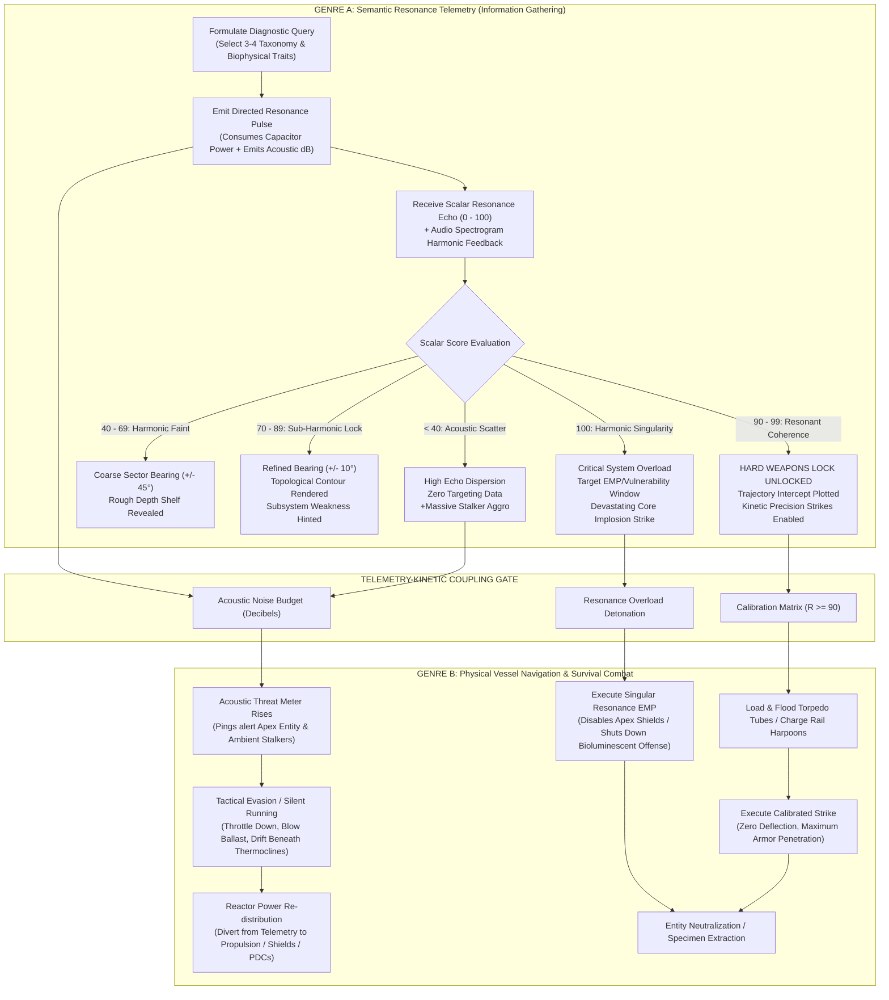
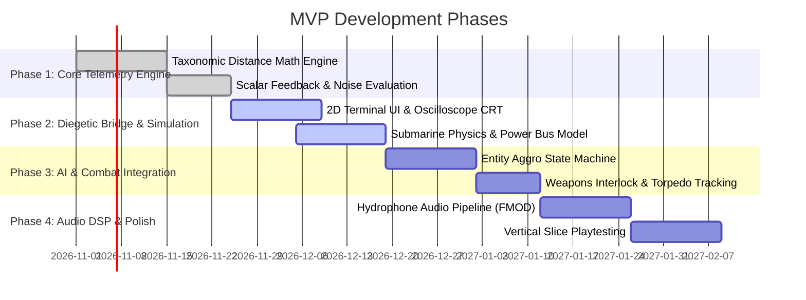

# GAME DESIGN DOCUMENT: RESONANCE PING (Working Title)
**Document Version:** 1.0.0 
**Lead Systems Designer & Technical Architect:** Principal Systems & Telemetry Lead 
**Target Genres:** Diegetic Submarine Simulation / Asymmetric Sensor Horror / Semantic Triangulation Tactical Combat 
**Reference Inspirations:** *In Other Waters*, *Iron Lung*, *FTL: Faster Than Light*, *Nauticrawl*, *Subcritical*, *Signal Head* 

---

## 1. EXECUTIVE SUMMARY & HIGH CONCEPT

### 1.1 The Pitch
**Resonance Ping** is a hardcore, diegetic submarine simulation and asymmetric information game where players navigate a lightless, super-pressurized benthic abyss. Unable to see outside their rusted titanium hull, players operate an array of analog stations—diverting reactor power, trimming ballast, and manually tuning acoustic/semantic sensor probes. 

Combat and navigation are impossible using conventional vision or simple radar. Instead, the crew must hunt and survive against colossal, anomalous biomechanical entities by playing a high-stakes, high-frequency game of **Semantic Hot-and-Cold**. By firing diagnostic frequency queries into the dark (testing for taxonomic traits like *Chitin Density*, *Neural Swarm Coherence*, *Thermal Cavitation*, or *Bio-Piezoelectric Resonance*), players receive scalar return scores (0–100). High scores calibrate kinetic targeting solutions, unmask trench topography, and expose fatal structural weak points. However, every acoustic query reverberates through the trench, generating acoustic noise that draws relentless benthic stalkers straight to the hull.

### 1.2 Core Pillars
1. **Diegetic Epistemic Dread:** No third-person cameras. No omniscient HUD. Every scrap of information about the abyss is filtered through flickering phosphor CRT screens, needle gauges, auditory waterfall spectrograms, and mechanical feedback.
2. **Semantic Triangulation as Weapons-Grade Telemetry:** The "hot-cold" scalar mechanism is not a minigame; it is the physical targeting computer and environmental cartography engine. Precision in semantic deduction equals survival in kinetic combat.
3. **Cascading Mechanical Debt:** Firing an off-resonance ping wastes reactor capacitors, screams into the water column, fails to lock the target, and invites immediate retaliation. Every choice has compounding physical consequences.
4. **Tactile Submarine Ergonomics:** Physical switches, mechanical breakers, pneumatic ballast levers, and acoustic hydrophone knobs enforce a deliberate, tense operational rhythm where panic leads to fatal human error.

---

## 2. THEMATIC WRAPPER & WORLD-BUILDING

### 2.1 The Setting: Hadal Void Trench "Tartarus-7"
Set in the late 21st century or an alternate retro-futuristic Cold War timeline, deep beneath the oceanic crust in the *Hadal Abyssal Siphons*—sub-crustal subterranean ocean trenches formed 11,000 meters beneath planetary sea levels. Deep within these ultra-deep trenches lie the **Archean Xenobiomes**: primordial, silicated, partially bio-metallic megafauna and crystalline signal-emitters that predate terrestrial biology.

### 2.2 The Vessel: Bathyscaphe *TRITON-IV "Scribe"*
The player commands the *Triton-IV*, an aging, deep-trench research and containment submarine.
- **Hull:** Multi-layered titanium-boron alloy, sealed under 1,100 atmospheres of hydrostatic pressure. A single structural breach is instantaneous implosion.
- **Visuals:** Zero external glass or viewing ports. Forward sight is impossible; benthic silt and total photic extinction render floodlights useless beyond 4 meters.
- **Power Core:** A finicky Liquid Sodium Thermal Reactor (LSTR) with a hard output ceiling of 100 Power Units (PU), requiring constant manual diversion between telemetry, ballast, propulsion, and weapon capacitor banks.

---

## 3. ASYMMETRIC LOOP ARCHITECTURE

The core gameplay loop is an asymmetric dual-system where the **Semantic Telemetry Loop (Genre A)** acts as the informational throttle for the **Mechanical Vessel Simulation Loop (Genre B)**.



### 3.1 The Coupling Gate Mechanics
- **The Calibration Threshold ($R \ge 90$):** Uncalibrated weaponry cannot guide itself in the turbulent hadopelagic soup. Torpedoes fired at $R < 80$ possess no active homing profile and suffer severe hydrodynamic deflection or armor bounce against the creature’s reinforced silicated hide.
- **The Acoustic Debt Multiplier:** Every query transmits physical energy into the water. A poorly tuned ping ($R < 40$) dissipates widely across benthic trench walls, producing an omnidirectional sound bloom that acts as a beacon for predatory fauna.

---

## 4. GENRE A: SCALAR PROXIMITY & FREQUENCY TRIANGULATION

### 4.1 The Semantic Query Synthesizer
Rather than rotating a simple radar dish, the Sensor Station operator configures a multi-band diagnostic query via a tactile rotary terminal. Each query consists of a combination of **Taxonomic Archetypes**, **Biophysical Matrices**, and **Resonant Carrier Frequencies**.

| Parameter Dial | Available Frequency Bands / Traits | Functional Meaning |
| :--- | :--- | :--- |
| **Domain Dial** | `[Litho-Silicate]`, `[Chitin-Arthropodic]`, `[Bio-Electric Cephalopod]`, `[Abyssal Siphonophore]`, `[Necrotic Benthic]` | Core taxonomic lineage of the target's physical composition. |
| **Structural Matrix** | `[Segmented Exoskeleton]`, `[Hydrostatic Gel]`, `[Crystalline Lattice]`, `[Fibrous Myofilament]`, `[Porous Sponge-Bone]` | Micro-density and armor absorption characteristics. |
| **Metabolic Output** | `[Thermal Vent Endothermic]`, `[Chemosynthetic Acid]`, `[Piezoelectric Discharge]`, `[Bioluminescent Biolink]`, `[Acoustic Cavitation]` | The energy signature and active biological emissions of the entity. |
| **Resonant Carrier** | `ELF (3-30 Hz)`, `VLF (3-30 kHz)`, `Ultrasonic (100-300 kHz)`, `Pulsed Harmonic Shear` | Acoustic carrier frequency utilized to bypass water column salinity/density layers. |

### 4.2 The Mathematical Distance Model: Taxonomic Cosine Distance in Latent Trait Space
Entities exist as normalized vectors in an $N$-dimensional biophysical attribute space:
$$\vec{T}_{\text{entity}} \in \mathbb{R}^N, \quad \|\vec{T}_{\text{entity}}\| = 1$$

When the player builds a query, they generate a query vector:
$$\vec{Q}_{\text{probe}} \in \mathbb{R}^N, \quad \|\vec{Q}_{\text{probe}}\| = 1$$

The base semantic correlation $S(\vec{Q}, \vec{T})$ is the dot product (cosine similarity):
$$S(\vec{Q}, \vec{T}) = \vec{Q}_{\text{probe}} \cdot \vec{T}_{\text{entity}} \in [-1, 1]$$

This is normalized to a base scalar $[0, 100]$:
$$R_{\text{base}} = \max\left(0, \frac{S(\vec{Q}, \vec{T}) + 1}{2} \times 100\right)$$

#### Environmental Attenuation & Turbidity Multiplier:
Water depth, trench thermoclines, and distance introduce an attenuation factor $\alpha(d, \Delta \theta, \eta)$:
$$R_{\text{final}} = R_{\text{base}} \times \left(1 - \frac{d}{d_{\text{max}}}\right) \times \cos(\Delta \theta) \times (1 - \eta)$$
Where:
- $d$: Spatial Euclidean distance to entity.
- $d_{\text{max}}$: Maximum sensor range (e.g., 2,500 meters).
- $\Delta \theta$: Angular deviation between probe transmitter beam cone and true entity bearing.
- $\eta \in [0, 0.4]$: Thermocline refraction / silt turbidity interference.

### 4.3 Scalar Threshold Feedback Breakdown

```
[00 - 39%] ACOUSTIC DISPERSION / VOID
  ├── Visual: Phosphor screen shows erratic, static noise rings.
  ├── Audio: Harsh, echoing metallic clang that reverbs endlessly into the trench.
  ├── Telemetry Data: None.
  └── Consequence: +15 dB Acoustic Noise Spike. Draws ambient Stalkers.

[40 - 69%] FAINT HARMONIC REVERBERATION
  ├── Visual: Rough quadrant blip emerges (e.g., "CONTACT SECTOR: N-NW").
  ├── Audio: Low-frequency rhythmic pulse with muffled biological clicks.
  ├── Telemetry Data: Bearing accurate within +/- 45 degrees. Coarse depth stratum revealed.
  └── Consequence: Target begins turning toward source if Noise > 60 dB.

[70 - 89%] SUB-HARMONIC LOCK
  ├── Visual: Wireframe contour of surrounding trench bathymetry sharpens. Vector speed calculated.
  ├── Audio: Clear harmonic resonance whistle; biological vocalization responds in kind.
  ├── Telemetry Data: Bearing accurate within +/- 10 degrees. Distance estimate within 50m.
  └── Consequence: Kinetic torpedoes can track with 50% hit probability.

[90 - 99%] RESONANT COHERENCE (FIRE SOLUTION LOCKED)
  ├── Visual: Bright, green-strobed lock brackets on targeting CRT. Exposed structural nodal points appear.
  ├── Audio: Sharp, ringing pure-tone chord. Creature's active carapace plates vibrate audibly against sub hull.
  ├── Telemetry Data: Bearing exact (+/- 0.5 deg). Weak-point targeted (e.g., "Exhaust Siphon / Ventral Nerve Bundle").
  └── Consequence: Weapons achieve 100% trajectory homing with critical kinetic multiplier.

[100%] HARMONIC SINGULARITY (CRITICAL OVERLOAD)
  ├── Visual: Complete structural vector breakdown. Internal organ layout visible.
  ├── Audio: Deep, room-shaking acoustic cavitation resonance.
  ├── Telemetry Data: Entity armor completely demagnetized/paralyzed for 15 seconds.
  └── Consequence: Unlocks "Resonance Cavitation Pulse"—detonating the creature from within.
```

---

## 5. GENRE B: REAL-TIME DIEGETIC VESSEL NAVIGATION & SURVIVAL COMBAT

### 5.1 Submarine Stations & Ergonomics
The player (or co-op crew) operates the *TRITON-IV* via distinct interactive operational stations arranged across the command deck:

1. **The Telemetry & Sensor Console:**
   - CRT Phosphor Waterfall Spectrogram (displays frequency returns over time).
   - Query Parameter Dials & Resonance Calibration Needle (0–100).
   - Directional Hydrophone Dial (allows listening manually to raw underwater soundscapes).
   - Frequency Transmitter Lever (fires the query pulse; requires manual capacitor charge).

2. **The Reactor & Power Distribution Matrix (FTL-Style Bus):**
   - Total Reactor Pool: **100 Power Units (PU)**.
   - Power must be actively routed via slider switches to five critical subsystems:
     * **Telemetry & Sensors:** Determines query pulse recharge speed, sensor beam focus, and spectral resolution.
     * **Engines & Propulsion:** Determines sub speed, maneuverability, and cavitation noise generation.
     * **Ballast & Hydroplanes:** Controls ascent/descent rate and ability to counter trench gravity wells.
     * **Capacitor & Weapons Bank:** Charges torpedo firing tubes, rail-harpoons, and electric defensive grids.
     * **Life Support & Scrubbers:** CO2 scrubbers, oxygen injection, and hull de-pressurizers. (Can be shut off temporarily for "Silent Running").

3. **The Helm & Ballast Station:**
   - Analog Compass Rose & Gyroscope Heading Display.
   - Dual Ballast Levers (Forward / Aft Ballast Tanks) with trim pneumatic gauges.
   - Throttle Telegraph (Dead Slow, 1/3, 2/3, Standard, Flank, Emergency Reverse).
   - Pressure Depth Barometer (Meters of depth + Redline Implosion Marker).

4. **The Tactical Weapons & Countermeasure Console:**
   - Tube 1 & Tube 2 Flood Valves and Pneumatic Pressure Levers.
   - Target Calibration Sync Port (Direct wire feeding data from Sensor Station).
   - Acoustic Decoy / Noisemaker Ejector Switch.
   - Cavitation Shield Discharger (Deflects incoming biological acid/spines).

```
+---------------------------------------------------------------------------------------+
|                TRITON-IV COMMAND BRIDGE                |
+------------------------------------+--------------------------------------------------+
|  [STATION 1: SENSOR / TELEMETRY] |  [STATION 2: REACTOR POWER DISTRIBUTION]    |
| +------------------------------+ | TOTAL REACTOR OUTPUT: [ 100 PU ]  CORE TEMP: 420K |
| | CRT SPECTROGRAM WATERFALL  | | [TELEMETRY]  [=====     ] 30 PU      |
| |  .. :::: | | :::: ..    | | [PROPULSION] [===      ] 20 PU      |
| |   RESONANCE: [ 94.2% ]   | | [BALLAST]   [==       ] 15 PU      |
| +------------------------------+ | [WEAPONS]   [====      ] 25 PU      |
| DOMAIN: [Arthropodic]       | [LIFE SUPP]  [=       ] 10 PU      |
| MATRIX: [Silicate-Carapace]    | =============================================== |
| FREQ:  [14.2 kHz ELF]      | ACOUSTIC SIGNATURE: [ 68 dB ] (WARNING: CAVITATION)|
+------------------------------------+--------------------------------------------------+
|  [STATION 3: HELM & BALLAST]   |  [STATION 4: WEAPONS & COUNTERMEASURES]     |
| HEADING: [ 284° W-NW ]      | TUBE 1: [HADAL-8 TORPEDO] - STATUS: FLOODED   |
| DEPTH:  [ 9,420 m ] (LIMIT: 11k) | TUBE 2: [ACOUSTIC DECOY] - STATUS: DRY     |
| BALLAST: FWD [45%] | AFT [48%]  | LOCK STATUS: [ CALIBRATION COHERENT - R: 94% ] |
| THROTTLE: [ 1/3 AHEAD - 4 KTS ]  | TARGET VECTOR: BRG 282° | RNG 420m | DPTH +40m  |
| [BLOW TANKS] [SILENT RUNNING]  | FIRE INTERLOCK: [ UNLOCKED ] >>> [ FIRE TUBE 1 ]|
+------------------------------------+--------------------------------------------------+
```

---

## 6. RISK / REWARD DYNAMICS: THE ACOUSTIC ECONOMY

### 6.1 The Acoustic Noise vs Information Friction
In the hadal abyss, sound is the only medium that travels, and it does so at ~1,520 meters per second. 
The player operates under a constant **Acoustic Noise Budget** measured in Decibels (dB) above ambient benthic quiet (ambient = 35 dB).

```
   NOISE (dB)
      ^
 100 -|------------------------------------------- [APEX HUNTING CHARGE THRESHOLD]
      |                                              (Leviathan sprints to attack)
  80 -|----------------------------------- [STALKER AGGRO THRESHOLD]
      |                                      (Small predatory swarms deploy)
  60 -|--------------------------- [CAVITATION WARNING]
      |                             (Entity enters active tracking state)
  40 -|------------------- [AMBIENT BENTHIC SILENCE]
      +------------------------------------------------------------> TIME
```

### 6.2 Noise Generation Matrix
Every ship action introduces a distinct acoustic signature into the water column:
- **Low-Resonance Ping ($R < 50$):** +25 dB (Acoustic scattering resonates off trench walls).
- **High-Resonance Ping ($R \ge 90$):** +8 dB (Acoustic energy is absorbed and converted by target tissue).
- **Flank Speed Throttle:** +35 dB (Propeller cavitation: boiling micro-bubbles collapse loudly).
- **Dead Slow (1/3 Speed):** +5 dB.
- **Pneumatic Ballast Blow:** +20 dB (High-pressure air rushes into ballast tanks).
- **Flooding Torpedo Tube:** +12 dB (Mechanical hydraulic clank and rush of sea water).
- **Silent Running Activated:** -20 dB (Kills scrubbers, limits helm to rudder only, battery reserve drain).

### 6.3 Environmental Acoustics: Thermoclines and Silt Plumes
Players are not navigating an empty void; the trench possesses tactical physical oceanography:
- **Thermoclines (Density Inversion Layers):** Sharp temperature/salinity gradients refract acoustic sound waves like mirrors. Submariners can trim ballast to slip *beneath* a thermocline. Firing a ping beneath a thermocline keeps the sound trapped below, preventing entities above from hearing the sub.
- **Black Smoker Hydrothermal Vents:** Generate intense background acoustic noise (~85 dB) and extreme heat. Lurking near a vent masks the submarine's propulsion noise, but blinds the sub's passive hydrophones and damages hull plating if too close.
- **Benthic Silt Trenches:** Maneuvering too close to the floor stirs up thick particulate clouds that disrupt optical/bioluminescent tracking and absorb acoustic energy, damping both entity pings and player sensors.

---

## 7. SCENARIO WALKTHROUGH: "HUNTING THE HADAL SIPHONOPHORE"

**Context:** The *TRITON-IV* has drifted to Depth 9,450m inside the *Nereus Chasm*. The target is an Apex Bio-Mechanical Organism codenamed **"Carcinus Dreadnought"**—a 60-meter, silicated-chitin leviathan armed with hyper-cavitating siphon jets.

```
T-00:00 [THE DRIFT]
Bridge is silent except for the low 50Hz hum of the sodium reactor and the groaning titanium hull. 
Reactor is set to 20 PU to Telemetry, 10 PU to Propulsion, 20 PU to Life Support. 
Passive Hydrophone operator hears a rhythmic, clicking grind on Bearing 275°.
Acoustic Signature: 38 dB. Ambient quiet.
```

```
T-01:15 [FIRST PROBE - THE WILD SHOT]
Sensor operator attempts a broad diagnostic pulse.
Dials set to: [Biomass: Mammalian Pelagic] / [Matrix: Dense Blubber] / [Freq: 8 kHz].
Transmitter lever pulled. A heavy metallic *CLANGGG* reverberates through the hull.
The return needle twitches: RESONANCE SCORE: 12.
Failure. Total acoustic scatter.
Waterfall display floods with white noise. 
Acoustic Signature spikes to 64 dB!
Hydrophone operator screams: "We echoed off the chasm wall! Contact just altered heading 40 degrees toward us!"
```

```
T-02:30 [DEDUCTIVE CORRECTION]
Commander orders: "Kill main throttle! Divert 30 PU to Telemetry! Think—this thing lives under 900 bar, it can't be soft tissue!"
Sensor operator pivots dials:
[Domain: Litho-Silicate Arthropod] / [Matrix: Segmented Exoskeleton] / [Freq: 14.2 kHz ELF].
Capacitor charges: 3... 2... 1... PING.
A clean, dampened pulse leaves the hull.
Return needle climbs smoothly... pauses... snaps to: RESONANCE SCORE: 78.
Topological CRT sharpens: A massive, 50-meter segmented silhouette appears on the green screen.
Bearing: 280° relative. Range: 680 meters. Depth: 40 meters below our keel.
Target has not accelerated; it is probing the dark.
```

```
T-03:45 [THE 92 VS 98 DILEMMA]
The weapons officer calls out: "Tube 1 flooded with Hadal-8 Torpedo, but lock interlock is red! We need 90+ to penetrate that silicate shell!"
Sensor operator refines the query. Two hypotheses remain:
Option Alpha: The creature utilizes piezoelectric discharge plates for propulsion -> [Trait: Piezo-Electric].
Option Beta: The creature is a colonial siphonophore with a central neural jelly node -> [Trait: Hydrostatic Neural Gel].

Sensor operator tests Option Alpha [Piezo-Electric]:
PING. Return: RESONANCE SCORE: 92.
Weapons interlock clicks AMBER: "Target Lock Acquired. Deflection: 4 degrees. Shell penetration probability: 65%."

Sensor operator gambles on Option Beta [Hydrostatic Neural Gel]:
PING. Return: RESONANCE SCORE: 98!
Weapons interlock flashes BRIGHT GREEN: "CRITICAL COHERENCE. Vulnerability unmasked: Ventral Ingestion Siphon."
CRT displays an illuminated bullseye right behind the dorsal armor plate.
```

```
T-04:20 [RETALIATION & STRIKE]
The 98% ping was so harmonically tuned that the creature's entire nervous system resonated, letting out an ear-piercing bio-acoustic shriek.
Creature initiates a 28-knot cavitation charge directly down Bearing 280°.
"Impact in 12 seconds!"
Commander: "Divert all spare power to Weapons! Fire Tube 1!"
Pneumatic release thuds through the deck: *THWUMP-HISSSS*.
The Hadal-8 Torpedo leaves the tube, locks into the 98% resonance guide-beam, and vectors directly toward the creature's exposed ventral siphon.
At 200 meters, the torpedo matches the creature's exact harmonic frequency, slipping directly under the deflected armor plating.
DETONATION.
A deep, concussive implosion wave slams into the Triton-IV. Hull creaks violently; rivets pop on bulkhead B.
CRT waterfall displays the target vector breaking apart into sinking, non-reactive debris.
"Target neutralized. Kill reactor throttle, blow forward trim 10%, let's drift out before the scavengers smell the blood."
```

---

## 8. TECHNICAL ARCHITECTURE & DATA SCHEMAS

### 8.1 Entity Relational & Taxonomic Distance Engine
The core system relies on a high-dimensional taxonomic vector engine. Below is the production-grade data schema implemented in TypeScript / C# style architecture.

```typescript
// ==========================================
// RESONANCE TELEMETRY ENGINE: DATA SCHEMAS
// ==========================================

export enum TaxonomicDomain {
  LITHO_SILICATE = "LITHO_SILICATE",
  CHITIN_ARTHROPODIC = "CHITIN_ARTHROPODIC",
  BIO_ELECTRIC_CEPHALOPOD = "BIO_ELECTRIC_CEPHALOPOD",
  ABYSSAL_SIPHONOPHORE = "ABYSSAL_SIPHONOPHORE",
  CRYSTALLINE_PRECURSOR = "CRYSTALLINE_PRECURSOR"
}

export enum StructuralMatrix {
  SEGMENTED_CARAPACE = "SEGMENTED_CARAPACE",
  HYDROSTATIC_GEL = "HYDROSTATIC_GEL",
  PIEZO_LATTICE = "PIEZO_LATTICE",
  FIBROUS_MYOFILAMENT = "FIBROUS_MYOFILAMENT",
  POROUS_CALCITE = "POROUS_CALCITE"
}

export enum MetabolicOutput {
  THERMAL_ENDOTHERMIC = "THERMAL_ENDOTHERMIC",
  CHEMOSYNTHETIC_ACID = "CHEMOSYNTHETIC_ACID",
  PIEZO_DISCHARGE = "PIEZO_DISCHARGE",
  BIOLUMINESCENT_LINK = "BIOLUMINESCENT_LINK",
  CAVITATION_JET = "CAVITATION_JET"
}

export interface AcousticSignature {
  currentDecibels: number;        // dB relative to ambient (35 dB)
  cavitationActive: boolean;      // True if propeller speed > threshold
  lastPingReverberationDb: number;// Echo noise still reflecting in trench
}

export interface Vector3D {
  x: number;
  y: number; // Depth
  z: number;
}

export interface EntityDefinition {
  id: string;
  codename: string;
  position: Vector3D;
  velocity: Vector3D;
  traits: {
    domain: TaxonomicDomain;
    matrix: StructuralMatrix;
    metabolism: MetabolicOutput;
    optimalCarrierKhz: number; // e.g., 14.2 kHz
  };
  attributeVector: number[]; // 16-dimensional normalized latent vector
  hullArmor: number;         // Armor hardness (0 - 100)
  aggroState: "DORMANT" | "PROBING" | "STALKING" | "CAVITATION_CHARGE";
}

export interface DiagnosticQuery {
  selectedDomain: TaxonomicDomain;
  selectedMatrix: StructuralMatrix;
  selectedMetabolism: MetabolicOutput;
  carrierFrequencyKhz: number;
  emitterPowerPu: number;     // Power units allocated to sensor
  azimuthBearingDeg: number;  // Direction of directional ping transmitter
}

export interface ResonanceReturn {
  scalarScore: number;        // 0 to 100
  bearingConfidenceDeg: number;// +/- degrees of uncertainty
  rangeEstimateMeters: number;
  topologicalResolution: number; // 0.0 to 1.0 (draws lines on CRT)
  weakpointExposed: boolean;
  generatedNoiseDb: number;
}
```

### 8.2 Resonance Calculation Implementation Algorithm

```typescript
export class ResonanceTelemetryComputer {
  private static readonly MAX_RANGE = 2500.0; // meters

  public static evaluatePing(
    query: DiagnosticQuery,
    subPosition: Vector3D,
    subHeadingDeg: number,
    target: EntityDefinition,
    ambientTurbidity: number // 0.0 (clean water) to 0.5 (heavy silt/thermocline)
  ): ResonanceReturn {
    // 1. Calculate physical vector distance & bearing
    const dx = target.position.x - subPosition.x;
    const dy = target.position.y - subPosition.y;
    const dz = target.position.z - subPosition.z;
    const distance = Math.sqrt(dx * dx + dy * dy + dz * dz);

    // Bearing to target
    const targetBearingDeg = (Math.atan2(dx, dz) * (180 / Math.PI) + 360) % 360;
    const angularDelta = Math.abs(query.azimuthBearingDeg - targetBearingDeg);

    // If target is beyond sensor envelope or ping cone (> 60 deg cone)
    if (distance > this.MAX_RANGE || angularDelta > 60.0) {
      return {
        scalarScore: 0,
        bearingConfidenceDeg: 180,
        rangeEstimateMeters: -1,
        topologicalResolution: 0,
        weakpointExposed: false,
        generatedNoiseDb: 25.0 // High scatter noise
      };
    }

    // 2. Calculate Semantic Taxonomy Match Score (Hot-Cold Core)
    let semanticMatches = 0;
    if (query.selectedDomain === target.traits.domain) semanticMatches += 35;
    if (query.selectedMatrix === target.traits.matrix) semanticMatches += 35;
    if (query.selectedMetabolism === target.traits.metabolism) semanticMatches += 20;

    // Carrier frequency tuning delta
    const freqDiff = Math.abs(query.carrierFrequencyKhz - target.traits.optimalCarrierKhz);
    const freqMultiplier = Math.max(0.0, 1.0 - freqDiff / 10.0) * 10; // Up to 10 points
    const rawTaxonomicScore = semanticMatches + freqMultiplier; // Max 100

    // 3. Distance & Environmental Attenuation
    const distanceFalloff = Math.max(0.1, 1.0 - (distance / this.MAX_RANGE));
    const beamAlignment = Math.cos(angularDelta * (Math.PI / 180));
    const environmentFactor = 1.0 - ambientTurbidity;

    // Final scalar calibration score
    const finalScore = Math.floor(rawTaxonomicScore * distanceFalloff * beamAlignment * environmentFactor);

    // 4. Acoustic Cost Evaluation
    // High resonance = absorbed by organism (+8 dB)
    // Low resonance = scattered across trench (+25 dB)
    const acousticNoise = finalScore >= 90 ? 8.0 : (25.0 - (finalScore * 0.15));

    return {
      scalarScore: finalScore,
      bearingConfidenceDeg: Math.max(0.5, 45.0 * (1.0 - finalScore / 100)),
      rangeEstimateMeters: finalScore > 40 ? Math.round(distance / 10) * 10 : -1,
      topologicalResolution: finalScore >= 70 ? (finalScore - 70) / 30 : 0,
      weakpointExposed: finalScore >= 90,
      generatedNoiseDb: acousticNoise
    };
  }
}
```

---

## 9. USER INTERFACE & DIEGETIC HUD SPECIFICATION

The game features **zero floating digital UI**. Every visual element is anchored within the physical cabin of the submarine, rendered with physical shaders (glass curvature, CRT scanlines, phosphor glow, dirt smudges, and mechanical needle jitter).

```
+-----------------------------------------------------------------------------------+
| CRT MONITOR A: TACTICAL WATERFALL & BATHYMETRY MAPPING              |
|                                          |
| FREQ (kHz)                                    |
|  30 |                                      |
|  20 |         ..:::| |:::..                       |
|  10 |    ...:::::                              |
|  0 +------------------------------------------------- TIME           |
|   [ ECHO DENSITY: 88.4% ]   [ CONTACT: VECTOR BRG 284° - RANGE: 410m ]   |
|                                          |
|   +-------------------------------------------------------------+       |
|   | BATHYMETRIC CONTOUR SCAN (VECTOR RECONSTRUCTION)      |       |
|   |                               |       |
|   |      / \                       |       |
|   |   _____/  \________ (TRENCH SHELF - DEPTH: 9,600m)   |       |
|   |        [ (X) TARGET LOCK: 94% ]          |       |
|   |                               |       |
|   +-------------------------------------------------------------+       |
+-----------------------------------------------------------------------------------+
| CRT MONITOR B: SEMANTIC RECEPTOR & SYSTEM CALIBRATOR               |
|                                          |
| [DOMAIN]    : [ CHITIN-ARTHROPODIC   ] [<- SELECT DIAL 1 ->]       |
| [MATRIX]    : [ SILICATE-CARAPACE    ] [<- SELECT DIAL 2 ->]       |
| [METABOLISM]  : [ CAVITATION JET     ] [<- SELECT DIAL 3 ->]       |
| [CARRIER FREQ] : [ 14.2 kHz ELF      ] [<- FINE TUNE KNOB ->]      |
|                                          |
| CALIBRATION LEVEL:                                |
| [ 0% ] ------------ [ 50% ] ------------- [ 90% ] ==== [ 100% ]         |
| [========================================|    ] 84% COHERENCE        |
|                                          |
| STATUS: SUB-HARMONIC LOCK // WEAPONS INTERLOCK ARMED (MARGINAL ACCURACY)     |
+-----------------------------------------------------------------------------------+
```

---

## 10. AUDIO PIPELINE & SOUND DESIGN DIRECTIVES

In a game without external visuals, **audio is 70% of the game's sensory bandwidth**. The audio design must deliver visceral physical feedback, tactical clarity, and psychological tension.

### 10.1 Dynamic DSP Audio Layers
1. **The Hydrophone Auditory Pass (Diegetic Listening):**
   - Direct hydrophone feed passed through a custom band-pass filter (high-pass at 40 Hz, low-pass at 4 kHz) simulating thick hadal seawater.
   - Distinct biological sound signatures:
     * *Silicate Leviathan:* Sub-bass clicking, like boulder crushing combined with rhythmic whale songs pitch-shifted down three octaves.
     * *Bio-Electric Cephalopod:* Modulated electromagnetic hums picked up on acoustic copper coils.
     * *Ambient Trench:* Distant tectonic rumblings, snapping hadal shrimp swarms (sounding like crackling fat in a pan).
2. **The Ping Resonance Audio Continuum (Scalar Feedback):**
   - **Low Match ($R < 40$):** A muffled, hollow *thump* followed by dissonant, grating echoes bouncing chaotically between stereo channels.
   - **Mid Match ($R = 50-80$):** A clear acoustic ping that triggers an eerie, resonant biological answer-frequency from the void.
   - **Near Perfect Match ($R = 90-99$):** Pure, crystalline harmonic resonance. The sound resonates through the submarine's own hull plating, making bridge metal physically vibrate.
   - **Singularity ($R = 100$):** A shattering, bass-heavy standing wave followed by structural implosion frequencies.
3. **Bridge Foley & Mechanical Strain:**
   - Depth creaks: At 9,000+ meters, random structural groans trigger in 3D space around the player.
   - High throttle causes realistic hydraulic pipe rattling, coolant hiss, and steam blow-offs.

---

## 11. MVP PROTOTYPE ROADMAP & SCOPE SPECIFICATIONS

To validate this hybrid genre loop rapidly, development is divided into four focused milestones:



### 11.1 Vertical Slice Deliverable Scope (The 15-Minute Loop)
- **Playable Space:** One trench sector (1,500m length, 300m width, 2,000m depth) with one central thermocline layer.
- **Vessel:** Single deck *Triton-IV* with 4 functional screens (Sensors, Reactor Power, Helm, Weapons).
- **Target Entity:** 1 Hadal Siphonophore Apex Entity + 2 Ambient Silt Stalkers.
- **Win Condition:** Correctly identify the taxonomic matrix of the Apex Entity, achieve $R \ge 90\%$, align vessel heading, and execute a precision torpedo kill.
- **Lose Condition:** Acoustic noise attracts the Apex Entity while uncalibrated, resulting in catastrophic hull breach and implosion.

---
*End of Game Design Document.*
